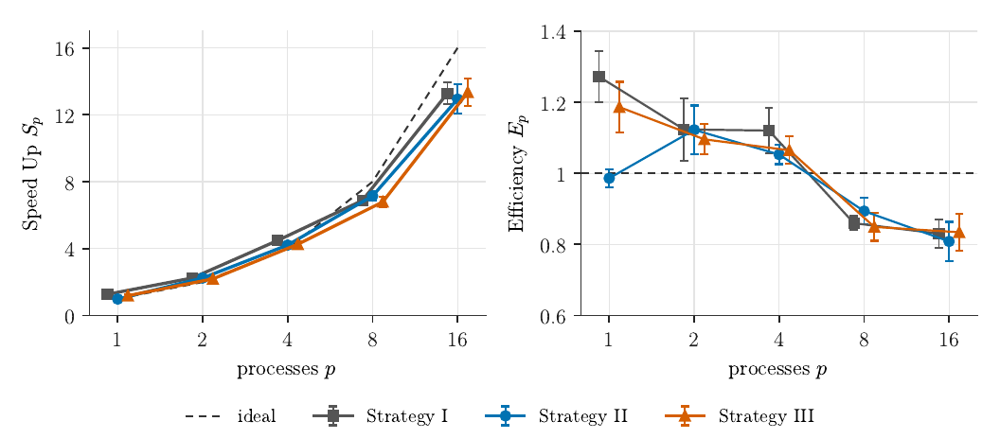
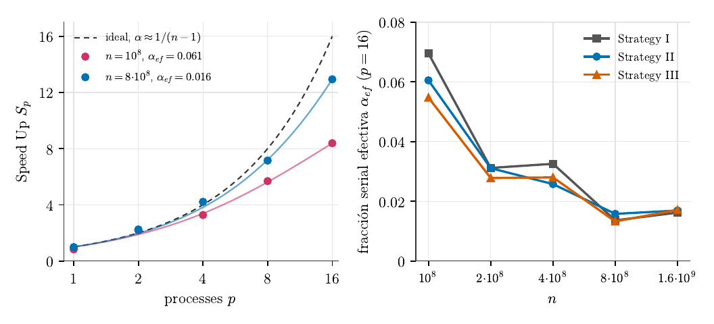
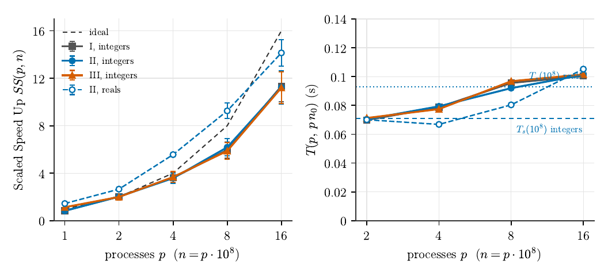

# Parallel sum with MPI: when memory is the limit

An experimental performance study of three parallel reduction strategies in C and MPI, summing up to **3.2 billion numbers** on a hybrid 24-core CPU (Intel Core Ultra 9 275HX: 8 performance + 16 efficiency cores).

The main finding: **the limit is not the algorithm but memory bandwidth**. With 16 processes the Speed Up reaches about 13, and the remaining gap to the ideal comes from all cores competing for the same memory bus. This is the same bottleneck that shapes distributed training of deep learning models.



## Key results

| | Result |
|---|---|
| Speed Up, 16 processes, n = 8·10⁸ | **≈ 13** (efficiency ≈ 0.8) |
| 2 and 4 processes | ideal or slightly superlinear (efficiency 1.05–1.12) |
| Difference between strategies | within measurement error (combination takes µs vs. 50 ms of local work) |
| Memory throughput, 16 processes | **≈ 63 GB/s**: each element costs 20–23 % more than ideal |
| Effective serial fraction (Karp–Flatt) | **0.016**, against 10⁻⁸ for the algorithm |
| Scaled efficiency, 10⁸ numbers per process | 1.0 (p = 2) → 0.70 (p = 16) |
| Integers vs. `float` reals | same parallel times: what matters is bytes read, not number type |

## The three strategies

| Strategy | How partial sums are combined | Steps | Real-world equivalent |
|---|---|---|---|
| **I. Sequential gather** | every process sends its sum to P0, which adds them one by one | p − 1 | parameter server |
| **II. Binary tree** | sums are combined in pairs; the result ends up in P0 | log₂ p | `MPI_Reduce`, NCCL tree |
| **III. Butterfly** | every process exchanges with a partner at distance 2ᵏ; all end up with the result | log₂ p | recursive-doubling *all-reduce* (PyTorch DDP, Horovod) |

## Why efficiency drops

- **Memory bandwidth.** Adding two numbers is almost free; reading them from main memory is not. All cores share the same bus, so each one reads more slowly as processes are added.
- **Heterogeneous cores.** With 16 processes at least half run on the slower E-cores, and the slowest process sets the total time.
- **Fixed costs.** Synchronisation and OS overhead add about 2 ms per run with 16 processes, which matters only for the smallest size.

| Amdahl's law | Scaled Speed Up |
|---|---|
|  |  |

## Relevance to machine learning

In data-parallel training, each GPU computes the gradients of its part of the batch and they are combined with an *all-reduce*: exactly strategy III, applied to vectors with billions of parameters. The lessons carry over directly. Data movement (memory, interconnect) usually limits performance more than arithmetic does. And efficiency depends on balancing local computation against communication, which is why large batches and fast interconnects matter.

## Repository structure

```
src/
  integers/   sequential program and strategies I, II, III (int)
  reals/      the same for real numbers (float data, double accumulation)
data/         spreadsheets with every measurement, statistics and charts
docs/         5-page summary (EN and ES) and the full 50-page technical report
figures/      main plots
```

Each program comes in two versions:

- `*.c` asks for `n` from the keyboard and measures once.
- `*_Multiple.c` runs automatically through n = 10⁸, 2·10⁸, …, 3.2·10⁹, repeats each measurement 3 times and prints tab-separated rows ready to paste into a spreadsheet.

## Build and run

Requires an MPI implementation (tested with OpenMPI on Ubuntu/WSL).

```bash
# base version: asks for n
mpicc -O2 -o strategyII src/integers/ParallelSumIntegers_StrategyII.c
mpirun -np 4 ./strategyII

# automatic version: all sizes, 3 repetitions, for p = 1, 2, 4, 8, 16
mpicc -O2 -o strategyII_multi src/integers/ParallelSumIntegers_StrategyII_Multiple.c
for p in 1 2 4 8 16; do mpirun -np $p ./strategyII_multi; done

# reals stored as double instead of float
mpicc -O2 -DDATA_TYPE=double -o reals src/reals/ParallelSumReals_StrategyII_Multiple.c
```

Compile with `-O2`: without optimisation the sequential and parallel loops are translated differently and the comparison is not fair. Strategies II and III need `p` to be a power of 2. The largest size needs about 13 GB of free RAM.

## Methodology

- Only the summation and the combination are timed, between two `MPI_Barrier` calls. The execution time is the maximum over all processes (`MPI_Reduce` with `MPI_MAX`).
- 3 repetitions per case; the error is the standard deviation, propagated to Speed Up `Sp = Ts/Tp` and efficiency `Ep = Sp/p`.
- The theoretical model `Tp = (n/p − 1 + C) · t_calc`, with `t_calc` fitted by least squares, is compared with the measurements for every strategy.

## Context

Carried out for the course *Calcolo Numerico II* (Numerical Computing II) at the Università degli Studi di Salerno, 2026. The base programs build on the course's reference implementation of the parallel sum.

**Author:** Gonzalo Rodríguez Peláez
